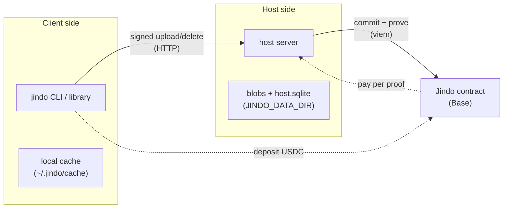

# jindo

Jindo is a decentralized storage system that produces a **cryptographically
verifiable agreement** between a data owner (the *client*) and a storage provider
(the *host*). Every change to what a host holds for a client is signed by the
client and committed on-chain, so neither side can later misrepresent what was
stored — and hosts are paid in USDC, but only while they keep proving they still
hold the data.

> **New here? Start with the [Getting Started runbook](docs/getting-started.md).**
> It takes you from nothing installed to a working host and client storing a real
> file, with every command spelled out. No blockchain experience needed.

---

## What you get

- A **host server** that accepts signed uploads/deletes, stores the bytes, posts
  each change to the Jindo contract, and proves on a schedule that it still holds
  the data (which is how it earns).
- A **CLI** (`jindo`) that runs either side: `jindo start` is the host;
  `jindo upload / delete / list / recover / deposit` are the client.
- A **library** (`src/lib`) exposing the same client logic and crypto primitives,
  so other programs can speak the protocol without shelling out.
- An **S3-compatible gateway** (`jindo s3`) so existing S3 tools and SDKs can read
  and write jindo-backed storage unchanged.
- **Folders**: upload a whole directory tree and browse it in a web browser.
- **USDC payments**: clients pre-pay a metered storage rate (~$0.023/GB/month);
  hosts collect it by submitting data-availability proofs.

A Solidity contract ([`contract/src/Jindo.sol`](contract/src/Jindo.sol)) is the
source of truth. For each `(host, client)` pair it stores the current Merkle root
and byte count, **verifies the client's EIP-712 signature on-chain** for every
change, holds the client's deposit, and pays the host per valid proof.

## How the pieces fit



The client signs an intent naming the prior root, the new root, and the new size.
The host won't act on an intent it can't verify, and the contract won't record a
change whose signature doesn't recover to the named client. So the host can't
fabricate state and the client can't disown a change they signed. The full story
is in [docs/concepts.md](docs/concepts.md).

## Documentation

| Doc | What it covers |
|---|---|
| **[Getting Started](docs/getting-started.md)** | **Start here.** Zero to a working host + client on Base Sepolia, step by step. |
| [Concepts](docs/concepts.md) | How it works: Merkle fingerprints, signed intents, payments, proofs, the trust model. |
| [CLI reference](docs/cli.md) | Every `jindo` command and its environment. |
| [Host operations](docs/host-operations.md) | Running a host for real: proofs, earnings, monitoring, backups, mainnet. |
| [Host HTTP API](docs/server.md) | The host server's routes and request shapes. |
| [Library](docs/library.md) | The programmatic API exported from `src/lib`. |
| [S3 gateway](src/s3/README.md) | The S3-compatible front end (buckets, objects, multipart, SigV4). |

## Try it in 60 seconds (no accounts, no faucets)

This runs the whole upload → on-chain → download loop on a throwaway local chain:

```bash
bun install
cd contract && forge test && cd ..          # the contract's own tests
bun test tests/s3.test.ts tests/merkle.test.ts tests/folder.test.ts
```

When you want a host you can actually point a client at, follow the
[Getting Started runbook](docs/getting-started.md).

## Repository layout

```
contract/        Foundry project — the Jindo Solidity contract, tests, deploy script
src/
  cli.ts         the jindo CLI entry point
  host/          the host server, proving, earnings withdrawal
  lib/           browser-safe client + crypto primitives (the importable library)
  node/          filesystem-backed bits (sqlite cache, folder upload, env loading)
  s3/            the S3-compatible gateway
  shared/        Merkle, EIP-712, chain, and ABI code shared by all sides
scripts/         deploy + tooling shell scripts
docs/            the documentation linked above
web/             a small browser demo
```

## Networks

Jindo targets **Base** out of the box. The deploy scripts cover Base Sepolia
(testnet, free) and Base mainnet:

```bash
bun run deploy:sepolia      # Base Sepolia — recommended for first use
bun run deploy:mainnet      # Base mainnet — asks for explicit confirmation
```

Both read configuration from `.env` (copy [`.env.example`](.env.example) and fill
it in). The contract isn't chain-specific, so any EVM chain with a USDC-like token
works if you supply the addresses.
