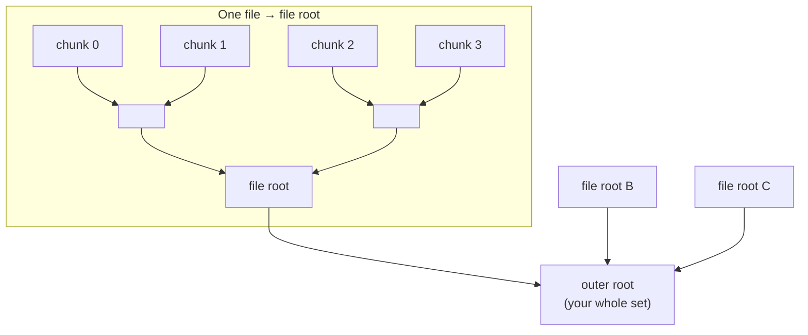
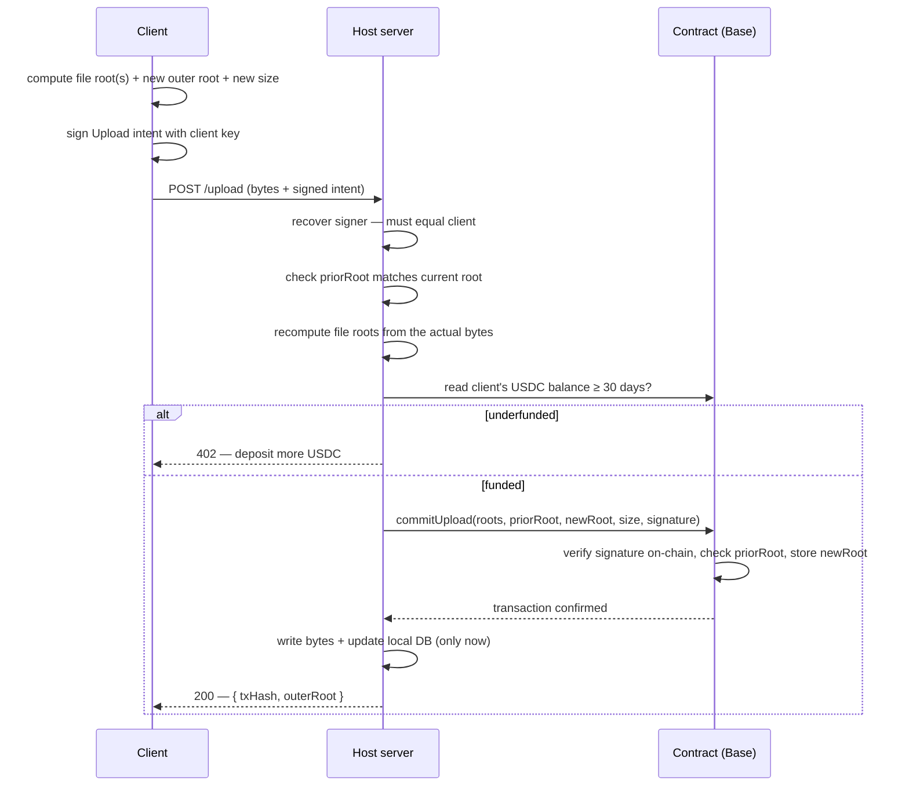
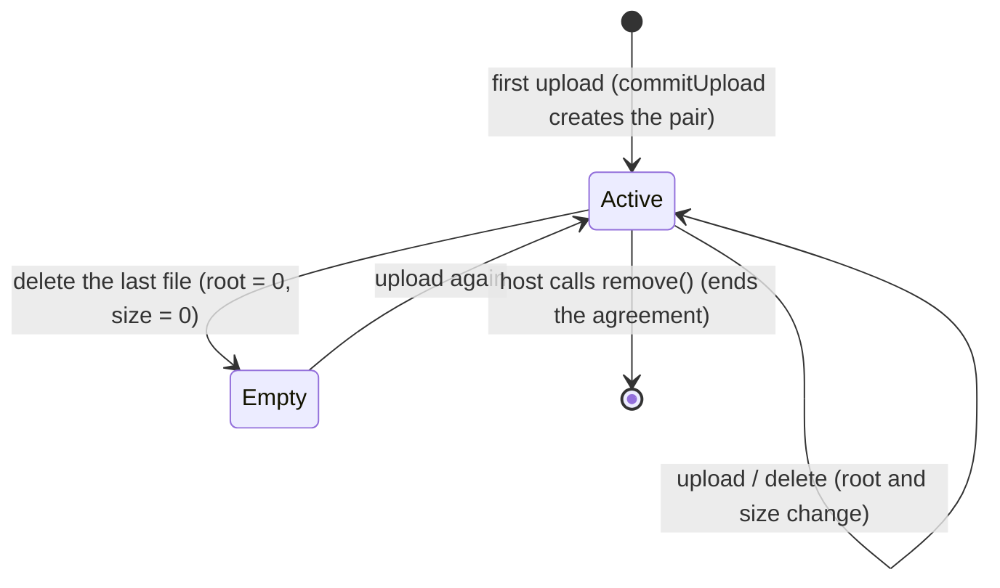
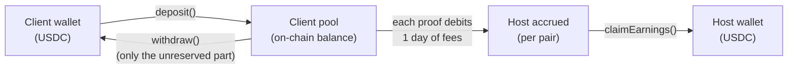

# How jindo works

This explains the ideas behind jindo. You don't need it to *use* jindo (see
[getting-started.md](getting-started.md) for that), but it's what makes the
system trustworthy rather than magic. Read top to bottom; each section builds on
the last.

---

## The problem jindo solves

You want someone else to store your data, but you don't want to *trust* them.
Specifically:

- The **host** should not be able to quietly drop, swap, or corrupt your files
  and pretend everything's fine.
- The **client** should not be able to upload something and later deny they asked
  for it.

Jindo settles both with cryptography and a public blockchain, so neither side has
to take the other's word.

---

## The three actors

| Actor | Holds | Role |
|---|---|---|
| **Client** | A private key + the original files | Owns the data. Signs every change. Pre-pays storage. |
| **Host** | A private key + a server + the bytes on disk | Stores the data. Posts every change to the contract. Gets paid for proving it still has the data. |
| **Contract** | On-chain state, per (host, client) pair | The neutral referee. Verifies signatures, records the current fingerprint and size, and moves the money. |

A single host serves many clients. A single client can use many hosts. Each
**(host, client) pair** is one independent agreement, identified on-chain by
`key(host, client)` — a hash of the two addresses.

---

## Fingerprints: Merkle roots

Jindo never puts your actual files on the blockchain (that would be enormous and
public-by-default). Instead it stores a tiny **fingerprint** — a *Merkle root* —
that uniquely represents the data. Change one byte and the fingerprint changes
completely; it's impossible to find different bytes with the same fingerprint.

There are two layers of fingerprint:

**1. The file root** — a fingerprint of one file. The file is split into 1 KiB
chunks; each chunk is hashed; the hashes are combined pairwise up a tree to a
single root. This is the file's identity. (Uploading the same bytes always
produces the same file root.)

**2. The outer root** — a fingerprint of your *whole set* of files. Its leaves are
the file roots. Because the tree sorts its inputs, the outer root depends only on
*which* files are in the set, not the order you uploaded them — which makes the
set easy to rebuild and reason about.



The **outer root is what lives on-chain.** It's the single value that says "this
is exactly the set of files this host holds for this client." The same Merkle
math is implemented three times — in TypeScript (client + host) and in Solidity
(the contract) — and all three must agree, or a change is rejected.

---

## Signed intents (EIP-712)

Every time the client's set changes, the client signs a message describing the
change *before* anything happens. These are **intents**, and they use EIP-712
(the same typed-data signing wallets like MetaMask show you).

An **Upload** or **Delete** intent names:

| Field | Meaning |
|---|---|
| `host`, `client` | who the agreement is between |
| `fileRoots` / `fileRoot` | the file(s) being added or removed |
| `priorRoot` | the outer root the client *believes* is current — a safety check |
| `newRoot` | the outer root after this change |
| `newSize` | the total byte count after this change |

The host cannot forge this signature, and — crucially — **the contract
re-checks the signature on-chain** and recovers the signer. If the recovered
signer isn't the named `client`, the transaction reverts. So a host can never
post a fingerprint the client didn't personally sign.

`priorRoot` is an optimistic-concurrency check: if the host's current root isn't
what the client expected (someone else changed the set first), the request is
rejected and the client re-syncs and retries. No locks, no lost updates.

---

## The upload, end to end

Here's everything that happens on a single `jindo upload`. The host only writes
to disk **after** the chain confirms — so the host's storage can never get ahead
of the public record.



If the chain transaction fails or never confirms, the host writes **nothing** and
returns an error. The host's state always equals the chain's state.

`delete` is the mirror image: the client signs a Delete intent, the host verifies
it, calls `commitDelete`, and only then removes the row and (if no other client
references the same bytes) the blob.

---

## What the contract stores

For each pair, the contract keeps a compact record:

```solidity
struct Contract {
    address host;
    uint64  size;            // total bytes stored
    address client;
    uint64  challengeIndex;  // which chunk the host must currently prove
    bytes32 root;            // the outer root — the fingerprint of the set
    uint64  lastProof;       // when the host last proved (gates daily payment)
    uint128 accrued;         // USDC earned by the host, awaiting claim
}
```

`root` and `size` are the agreement. `challengeIndex`, `lastProof`, and `accrued`
drive the proof-and-payment loop below.

### Pair lifecycle



Deleting your last file leaves the pair in place but empty (fingerprint and size
both zero). A host can fully tear down a pair with `remove()` to reclaim the
on-chain slot.

---

## Paying for storage

Storage is metered in USDC. The model is simple once you see the four moves.

**The rate.** The contract charges a fixed **~$0.023 per GB per month**
(internally `714,300` atto-USDC per byte per day, where 1 atto = 10⁻¹⁸ USDC).
Everything is tracked in these tiny atto units and only converted to whole USDC
when money actually moves.

**The four moves:**



1. **Deposit.** The client calls `deposit` (the `jindo deposit` command). USDC
   moves from the client's wallet into a **single pool** on the contract. One pool
   funds *all* the client's hosts.

2. **Reserve.** A host accepts an upload only if the pool holds at least **30 days
   of fees** for the client's new total size. The same 30-day reserve also limits
   how much the client can `withdraw` — you can't fund a host and immediately pull
   the money back out, starving it.

3. **Accrue.** Each time the host submits a valid proof (next section), the
   contract moves **one day's fee** from the client's pool to that host's
   `accrued` balance for the pair. Pure bookkeeping — no token transfer yet.

4. **Claim.** The host calls `claimEarnings` (the `jindo withdraw` command) to
   pull whole USDC units of `accrued` into its wallet. Sub-cent dust stays until
   the next claim.

The key consequence: **a host only earns by repeatedly proving it still holds the
data.** Stop proving and the income stops.

---

## Proofs: the host must keep the data

A fingerprint on-chain proves the host *once had* the right data. It doesn't prove
the host *still* has it. Proofs close that gap.

The contract continuously picks a **challenge**: a pseudo-random chunk index into
the client's data (seeded by a recent block hash, so the host can't predict it
ahead of time). To get paid, the host must answer with:

- the actual bytes of that specific chunk, and
- two Merkle proofs showing that chunk belongs to the committed outer root.

The contract re-runs the Merkle math. A host that deleted or corrupted the data
cannot produce a valid proof for a chunk it no longer holds. On success the
contract pays one day of fees (the accrual above) and rotates to a new random
challenge.

Two rules keep it honest and cheap:

- **One paid proof per UTC calendar day, per pair.** A host can't farm a single
  day's data for many payments. Miss a day and that day's revenue is simply
  forfeit.
- The host's server does this automatically on a timer (every 12 hours by
  default; see `JINDO_PROVE_INTERVAL_MS` in [host-operations.md](host-operations.md)),
  and you can trigger it manually with `jindo prove <client>`.

---

## The trust model, summarized

| Concern | How jindo handles it |
|---|---|
| Host swaps or corrupts your file | The client signs the file's Merkle root; the host can't substitute bytes without breaking it. Random-chunk proofs catch later corruption. |
| Host posts a fingerprint you never approved | The contract recovers the client's signature **on-chain** and reverts if it doesn't match. |
| Host claims to store data it deleted | It can't produce a valid proof for the random challenge chunk, so it stops getting paid. |
| Someone replays an old signed intent | Each intent is bound to a specific `priorRoot → newRoot` transition that can only apply once. |
| Two uploads race | Optimistic `priorRoot` check + a per-client lock on the host serialize them; the loser re-syncs and retries. |
| Client funds a host then yanks the money | The 30-day reserve blocks withdrawals that would drop the pool below a month of coverage. |
| Anyone downloads your bytes | **Intentional — downloads are public.** Don't upload secrets; encrypt before uploading if you need privacy. |

### Known limitations

- **Public downloads.** Anyone with a file root can fetch the bytes.
- **Cross-host pool griefing.** The client's deposit pool is global and drained
  first-come-first-served across hosts on a given day. For a single-operator
  deployment (one host, cooperative clients) this is a non-issue; the contract
  source documents the mitigations for an open multi-host marketplace.
- **No host discovery.** Clients point at a host by URL (`--host`); there's no
  on-chain registry of hosts yet.

For the precise on-chain rules, the contract source
([`../contract/src/Jindo.sol`](../contract/src/Jindo.sol)) is heavily commented
and is the source of truth.
