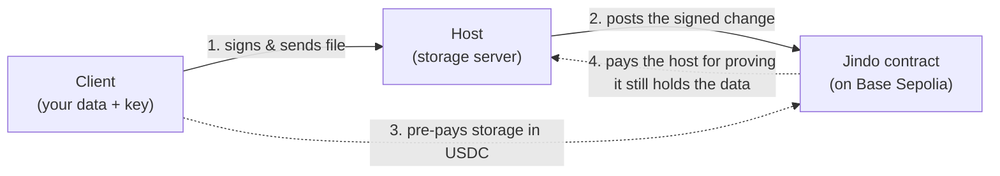

# Getting started

This guide takes you from **nothing installed** to a **working jindo host and
client** that store a real file with an on-chain receipt. No prior blockchain
experience required — every command and every value you need is spelled out.

It uses **Base Sepolia**, a free test network. You will not spend real money.

> **Just want to confirm it works on your machine, with zero accounts or
> faucets?** Jump to [Appendix A: the zero-setup local run](#appendix-a-the-zero-setup-local-run).
> That spins up a throwaway local blockchain and exercises the whole
> upload → on-chain → download loop in one command. Come back here when you want
> a host you can actually point a client at.

---

## The 60-second mental model

Jindo has exactly three actors. You will play two of them on one laptop.

| Actor | What it is | What it needs |
|---|---|---|
| **Client** | Owns the data. Signs a message every time its files change. | A wallet key, a little test ETH (for two setup transactions), and some test USDC (to pre-pay for storage). |
| **Host** | Runs a server, stores the bytes, and posts every change to the blockchain. | A wallet key and a little test ETH (it pays the gas for storage transactions). |
| **Contract** | A program living on Base Sepolia. The referee. It records, for each (host, client) pair, *what* is stored (a fingerprint) and *how much*. | Nothing — it's already-deployed code. You deploy your own copy once. |

The one idea that makes jindo tick: **the client signs a fingerprint of its
files, and the host cannot post anything to the contract that the client didn't
sign.** So the host can't lie about what it's holding, and the client can't deny
what it asked the host to store. If you want the full picture, read
[concepts.md](concepts.md) — but you don't need it to finish this guide.



You will set up the host and client **in two separate terminals**, each with its
own wallet key.

---

## Step 1 — Install the tools

You need three command-line tools. Install them, then verify each one.

### Bun (the JavaScript runtime jindo is written in)

```bash
curl -fsSL https://bun.sh/install | bash
```

Close and reopen your terminal, then check:

```bash
bun --version          # expect 1.3 or newer
```

### Foundry (the toolkit for deploying and inspecting the contract)

This gives you three commands: `forge` (build/deploy), `cast` (make wallets, read
the chain), and `anvil` (a local test blockchain).

```bash
curl -L https://foundry.paradigm.xyz | bash
foundryup
```

Check:

```bash
forge --version        # expect a version line
cast --version
anvil --version
```

### git

Most systems already have it.

```bash
git --version
```

---

## Step 2 — Get the code

```bash
git clone --recurse-submodules https://github.com/<your-org>/jindo.git
cd jindo
bun install
```

> If you already cloned without `--recurse-submodules`, run
> `git submodule update --init --recursive` now. The contract's test library
> lives in a submodule and the build needs it.

Build the contract once so the deploy step has compiled bytecode:

```bash
cd contract && forge build && cd ..
```

You should see `Compiling ...` then a success line. If `forge build` fails, your
submodule probably isn't checked out — re-run the submodule command above.

---

## Step 3 — Make two wallets

A **wallet** here is just a private key — a 64-character secret that controls an
address. You need two: one for the host, one for the client. They **must be
different keys**.

```bash
cast wallet new
```

Run it **twice**. Each run prints something like:

```
Successfully created new keypair.
Address:     0xAbC1...                 ← public, shareable
Private key: 0x59c6...                 ← secret, NEVER share
```

Label them in a scratch file so you don't mix them up:

```
HOST    address 0x....   key 0x....
CLIENT  address 0x....   key 0x....
```

> **These are test keys for a test network. Never put a key that controls real
> funds in a `.env` file or a terminal command.** Treat the two keys above as
> throwaway.

---

## Step 4 — Fund the wallets (free)

Base Sepolia transactions cost a tiny amount of **test ETH** (for gas), and the
client pre-pays storage in **test USDC**. Both are free from faucets.

**Who needs what:**

| Wallet | Test ETH | Test USDC |
|---|---|---|
| **Host** | ✅ yes — it pays gas for every upload, delete, and proof | ❌ no |
| **Client** | ✅ a little — it pays gas for two setup transactions (approve + deposit) | ✅ yes — this is what funds storage |

Notice the client only pays gas **twice, ever** (to approve and deposit USDC).
After that, every upload and delete is paid for by the host. That's by design.

### Get test ETH

Send a small amount of Base Sepolia ETH to **both** the host and client
addresses. Any Base Sepolia faucet works; common ones:

- <https://www.alchemy.com/faucets/base-sepolia>
- <https://docs.base.org/chain/network-faucets> (Base's own list)

A fraction of an ETH is plenty for thousands of transactions.

### Get test USDC (client only)

Use Circle's testnet faucet and pick **Base Sepolia**, then send the USDC to your
**client** address:

- <https://faucet.circle.com>

A few dollars of test USDC is far more than you'll need — storage costs about
**$0.023 per GB per month**, so even **1 USDC covers tens of gigabytes for a
month**.

### Confirm the funds arrived

```bash
# Host and client ETH balance (should be non-zero):
cast balance <HOST_ADDRESS>   --rpc-url https://sepolia.base.org
cast balance <CLIENT_ADDRESS> --rpc-url https://sepolia.base.org

# Client USDC balance (6 decimals — 1000000 = 1 USDC):
cast call 0x036CbD53842c5426634e7929541eC2318f3dCF7e \
  "balanceOf(address)(uint256)" <CLIENT_ADDRESS> \
  --rpc-url https://sepolia.base.org
```

---

## Step 5 — Configure `.env`

Copy the template:

```bash
cp .env.example .env
```

Open `.env` and set these. The file holds the **shared settings** plus the
**host identity**; you'll pass the client's key separately in Step 8, so you
never have to juggle two `.env` files.

```bash
# Network — Base Sepolia (already the default in the template)
JINDO_RPC_URL=https://sepolia.base.org

# Host identity: the host's private key from Step 3
JINDO_PRIVATE_KEY=0x<HOST_KEY>

# Deployer: reuse the host key — the host deploys its own contract
DEPLOYER_PRIVATE_KEY=0x<HOST_KEY>

# Leave JINDO_CONTRACT blank for now — you'll fill it in after Step 6
JINDO_CONTRACT=

# Host server settings (defaults are fine)
JINDO_PORT=5689
JINDO_DATA_DIR=./data
```

Leave `JINDO_USDC` commented out — the deploy script automatically uses Base
Sepolia's USDC address for you.

> **Why is the host the deployer?** Whoever deploys just pays the one-time gas to
> publish the contract. Reusing the host key keeps this guide to two wallets.
> In a real deployment they can be different.

---

## Step 6 — Deploy the contract

This publishes your own copy of the Jindo contract to Base Sepolia.

```bash
bun run deploy:sepolia
```

You'll see a summary (chain, deployer, balance, USDC address), then a deployment
result ending with:

```
════════════════════════════════════════════════════════════
 deployed   : 0x1234....
════════════════════════════════════════════════════════════

Update .env:
  JINDO_CONTRACT=0x1234....
```

**Copy that address into `.env`:**

```bash
JINDO_CONTRACT=0x1234....
```

If the deploy fails with a balance error, your host wallet has no test ETH — go
back to Step 4.

---

## Step 7 — Start the host (terminal 1)

In your first terminal, from the repo root:

```bash
bun src/cli.ts start
```

You should see:

```
jindo host listening on http://0.0.0.0:5689 as 0xHOST... (chain 84532, contract 0x1234...)
[prove-all] scheduled every 43200000ms (first sweep in 30000ms)
```

That's it — the host is live and listening on **http://localhost:5689**. Leave
this terminal running. You can sanity-check it from another shell:

```bash
curl http://localhost:5689/health
# {"address":"0xHOST...","chainId":84532,"contract":"0x1234..."}
```

---

## Step 8 — Be a client (terminal 2)

Open a **second terminal**, in the same repo directory. Here you'll act as the
client. Because the client uses a *different* key than the host, save it to a
shell variable once so every command can reuse it:

```bash
export CLIENT_KEY=0x<CLIENT_KEY>
```

Every client command below is prefixed with `JINDO_PRIVATE_KEY=$CLIENT_KEY`.
That overrides the host key in `.env` for that one command — everything else
(RPC URL, contract address) is read from `.env`.

### 8a. Deposit USDC to pre-pay for storage

The host refuses uploads from a client whose on-chain balance can't cover **30
days** of storage. So fund your pool first. 1 USDC is plenty:

```bash
JINDO_PRIVATE_KEY=$CLIENT_KEY bun src/cli.ts deposit 1
```

This sends two transactions (an `approve` and a `deposit`) and prints their
hashes. When it says `deposit mined — 1 USDC credited`, you're funded.

### 8b. Upload a file

```bash
echo "hello jindo" > hello.txt

JINDO_PRIVATE_KEY=$CLIENT_KEY bun src/cli.ts upload ./hello.txt --host http://localhost:5689
```

Output:

```
uploaded 1 file(s):
  ./hello.txt  →  0xFILEROOT...
```

That `0xFILEROOT...` is the file's **fingerprint** (its Merkle root) — jindo's
handle for the file. Over in terminal 1 you'll see the host log the upload, the
balance check, and the on-chain transaction.

> You can upload several files at once: `... upload a.txt b.png c.pdf --host ...`.
> They go up as a single signed batch. To upload a whole directory tree, see
> [`upload-folder`](cli.md#jindo-upload-folder-dir---host-url).

### 8c. List what you've stored

```bash
JINDO_PRIVATE_KEY=$CLIENT_KEY bun src/cli.ts list --host http://localhost:5689
```

```
host:   0xHOST...
client: 0xCLIENT...
outer:  0x...            ← the combined fingerprint of your whole set
size:   12 bytes
  0xFILEROOT...  12B  @1735689600
```

### 8d. Download the file (anyone can)

Downloads are public — no key needed. Use the file root from the upload:

```bash
curl http://localhost:5689/download/0xFILEROOT... -o downloaded.txt
cat downloaded.txt        # → hello jindo
```

### 8e. Delete the file

```bash
JINDO_PRIVATE_KEY=$CLIENT_KEY bun src/cli.ts delete 0xFILEROOT... --host http://localhost:5689
```

Prints the transaction hash. `list` will now show `(no files)`.

### 8f. Recover (rebuild your local view from the host)

The client keeps a small local cache (default `~/.jindo/cache`). If you lose it —
new laptop, wiped disk — `recover` rebuilds it from the host **and verifies every
file against the on-chain fingerprint before trusting it**:

```bash
JINDO_PRIVATE_KEY=$CLIENT_KEY bun src/cli.ts recover --host http://localhost:5689
```

This is also the fix if a command ever complains the cache is *out of sync* with
the chain.

**🎉 You've run the full loop: deploy → host → deposit → upload → list → download
→ delete → recover.**

---

## Step 9 — Get the host paid (optional)

Storage isn't actually free — the client's deposit slowly flows to the host, but
only when the host **proves it still holds the data**. The host you started in
Step 7 does this automatically every 12 hours. You can also trigger it by hand:

```bash
# (terminal 1's repo, host identity from .env)
bun src/cli.ts prove 0xCLIENT...     # answer the current challenge for this client
bun src/cli.ts withdraw              # claim everything earned, across all clients
```

A proof can only be submitted **once per UTC day per client**, and each one
moves at most one day's fee from the client's pool to the host. So on a fresh
upload there's nothing to claim yet — come back tomorrow, or read
[host-operations.md](host-operations.md) for the full earnings lifecycle.

---

## Troubleshooting

| Symptom | Cause & fix |
|---|---|
| `missing env JINDO_PRIVATE_KEY` (or `..._RPC_URL` / `..._CONTRACT`) | A required variable isn't set. Check `.env`, and that you prefixed client commands with `JINDO_PRIVATE_KEY=$CLIENT_KEY`. |
| `private key must be 32-byte hex` | The key must start with `0x` and be 64 hex characters. |
| Deploy aborts: `deployer has 0 ETH` | The host/deployer wallet has no test ETH. Fund it (Step 4). |
| Upload rejected, `402 client balance insufficient` | The client hasn't deposited enough USDC to cover 30 days for the new total size. Run `deposit` with a bit more (Step 8a). |
| Upload rejected, `409 priorRoot mismatch` or a `cache out of sync` error | Your local cache disagrees with the chain. Run `recover` (Step 8f), then retry. |
| Upload rejected, `401 signature does not match` | The client key signing the request differs from the `client` address in it — usually a key mix-up. Make sure `$CLIENT_KEY` is the client's key, not the host's. |
| `forge build` fails / `Jindo.json` not found | Submodule not checked out, or you skipped Step 2's build. Run `git submodule update --init --recursive`, then `cd contract && forge build`. |
| Host log shows `chain submission failed` | The host wallet ran out of test ETH, or the RPC is flaky. Top up ETH; consider a dedicated RPC (see below). |
| Everything is slow or times out | The public `https://sepolia.base.org` RPC is rate-limited. Get a free RPC URL from Alchemy/QuickNode and put it in `JINDO_RPC_URL`. |

---

## Where to go next

- **[concepts.md](concepts.md)** — how jindo actually works: Merkle fingerprints,
  the signed intents, the payment model, and proofs. Read this to understand
  *why* the steps above are safe.
- **[cli.md](cli.md)** — every `jindo` command and flag.
- **[host-operations.md](host-operations.md)** — running a host beyond a laptop:
  proofs, earnings, monitoring, backups.
- **[server.md](server.md)** — the host's HTTP API.
- **[library.md](library.md)** — drive jindo from your own TypeScript instead of
  the CLI.
- **[../src/s3/README.md](../src/s3/README.md)** — put an S3-compatible API in
  front of a host so existing S3 tools work unchanged.

---

## Appendix A: the zero-setup local run

Want to watch the entire system work without making wallets or visiting faucets?
The test suite spins up a local throwaway blockchain (`anvil`), deploys the
contract **and a mock USDC token**, funds a client, and runs upload → on-chain
commit → download → delete end to end.

```bash
# The contract's own tests (40 of them — pure Solidity, no network):
cd contract && forge test && cd ..

# The host + client + S3 gateway, against a local anvil chain:
bun test tests/s3.test.ts tests/merkle.test.ts tests/folder.test.ts
```

Watch the `[upload]` and `[s3]` log lines scroll past — that's a real host
verifying signatures, committing to the local chain, and serving bytes back. It's
the same code path the runbook above uses, just wired to a disposable chain with
fake money.

> Note: `tests/integration.test.ts` is an older end-to-end test that predates the
> USDC payment system and does not currently pass — the suites listed above are
> the ones that exercise the current code.
